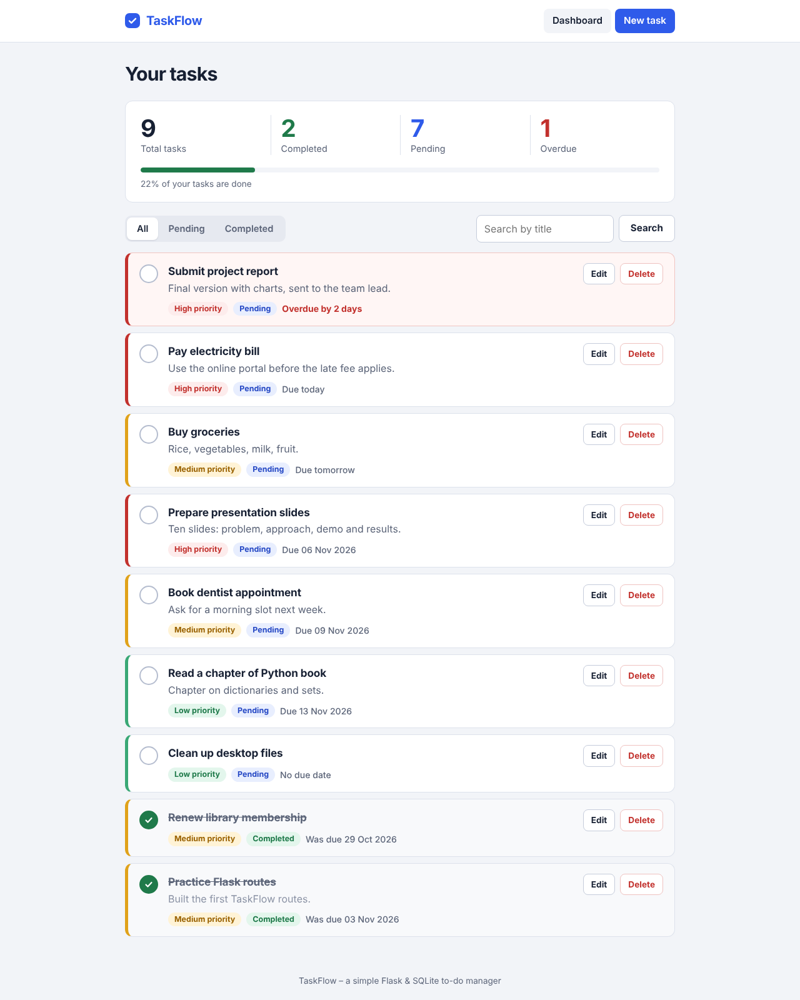
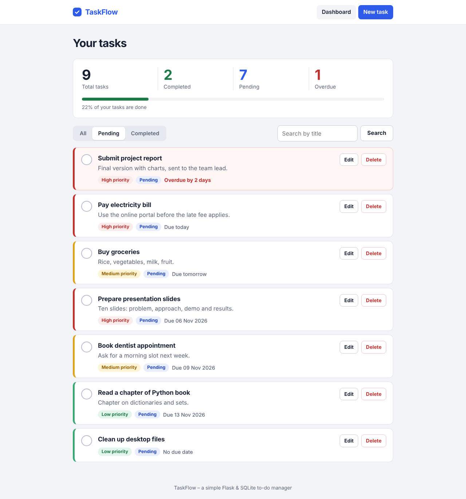
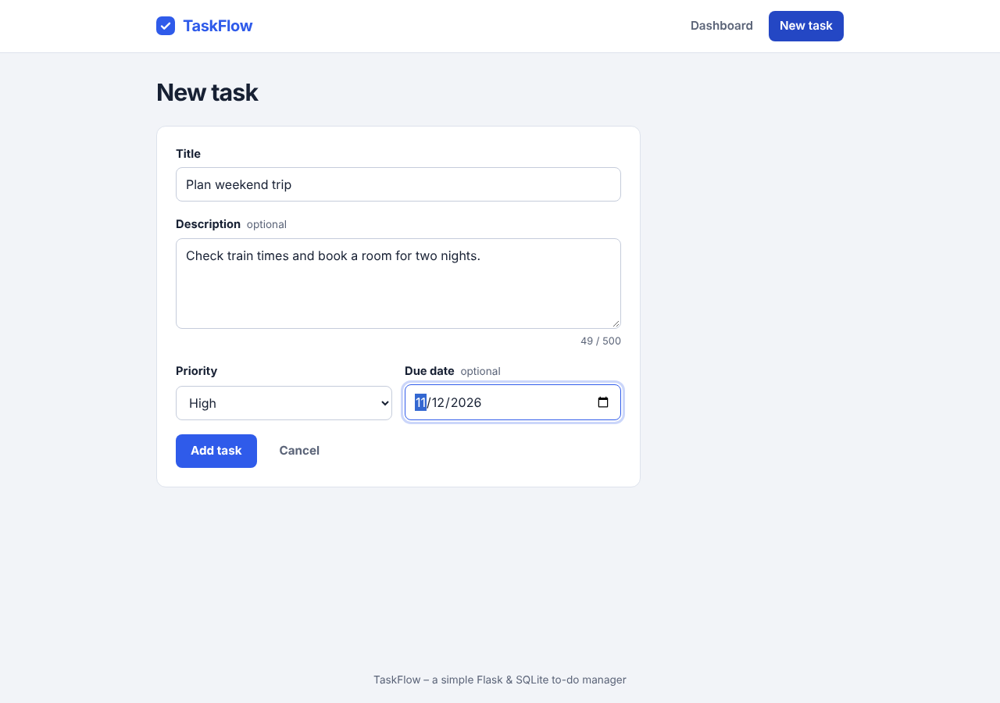
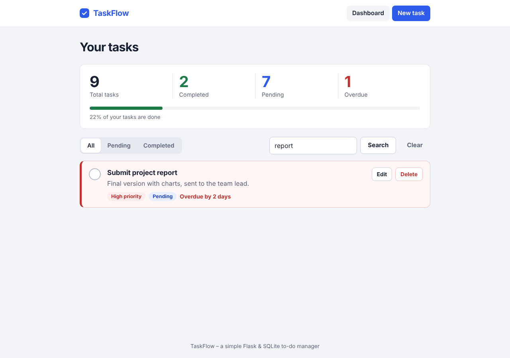
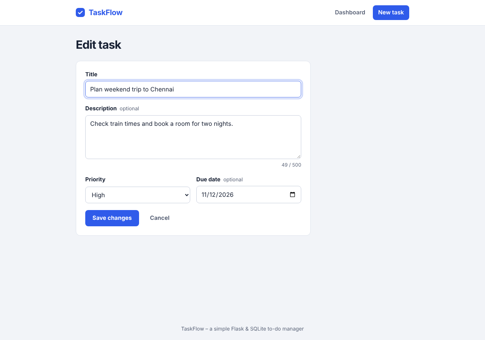
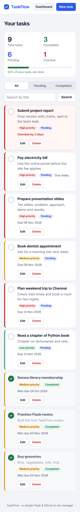
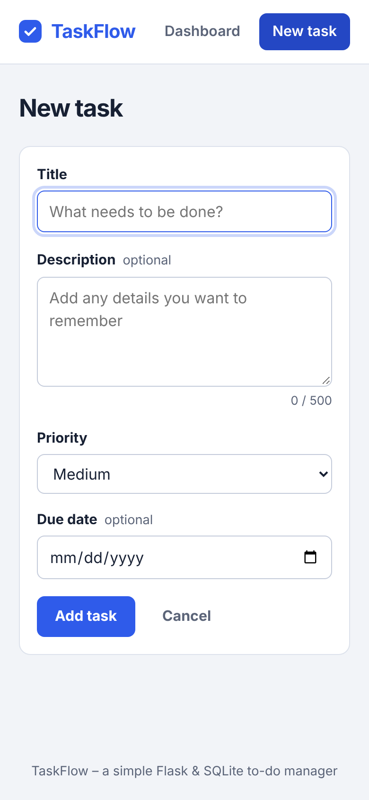

# TaskFlow – To-Do List Manager

A simple, professional task manager built with **Python, Flask, SQLite, HTML, CSS and JavaScript**.
It is designed for Python beginners: small files, clear comments and no unnecessary libraries.



## Features

- Add tasks with a title and description
- Edit and delete tasks (with a delete confirmation)
- Mark tasks as completed or pending with one click
- Priorities: High, Medium, Low (colour-coded)
- Optional due dates, with friendly labels ("Due today", "Overdue by 2 days")
- Filter by All, Pending or Completed
- Search tasks by title (works together with the filter)
- Dashboard counters: total, completed, pending (plus overdue) and a progress bar
- Overdue tasks are highlighted in red
- Tasks are stored permanently in a SQLite file
- Responsive layout for desktop and mobile

## Technologies

| Part | Technology |
|------|------------|
| Backend | Python 3.9+ and Flask |
| Database | SQLite (built into Python, no setup) |
| Frontend | HTML (Jinja templates), CSS, JavaScript |

Only one package needs to be installed: **Flask**.

## Project structure

```
taskflow/
├── app.py               # Flask app and routes (the web pages)
├── database.py          # SQLite connection + table creation
├── models.py            # Task class and TaskRepository (CRUD)
├── seed_demo.py         # Optional: adds sample tasks
├── requirements.txt     # Python packages needed
├── .gitignore           # Files Git should ignore
├── README.md
├── templates/
│   ├── base.html        # Shared page layout (header, messages, footer)
│   ├── index.html       # Dashboard: stats, filter, search, task list
│   ├── task_form.html   # Add / edit form
│   └── 404.html         # "Page not found" page
├── static/
│   ├── css/style.css    # All styling and responsive rules
│   └── js/script.js     # Delete confirmation, message close, character counter
├── tests/
│   └── test_app.py      # 25 automatic tests
└── screenshots/         # Images used in this README
```

## What each Python file does

### `database.py` – talking to SQLite
- `DatabaseError` – our own error type, so the app can show friendly messages.
- `get_connection()` – opens the database file.
- `init_db()` – creates the `tasks` table if it does not exist (safe to run every time).

### `models.py` – the data and the CRUD operations
- `Task` (class) – one task. Helpful properties: `is_overdue`, `due_label`, `due_date_iso`.
- `TaskRepository` (class) – every database action:
  - `create()` – add a task (**C**reate)
  - `get_all(status, search)` and `get_by_id()` – read tasks (**R**ead)
  - `update()` and `toggle_status()` – change a task (**U**pdate)
  - `delete()` – remove a task (**D**elete)
  - `get_stats()` – counts for the dashboard

### `app.py` – the website
| Route | What it does |
|-------|--------------|
| `/` | Dashboard with filter (`?filter=pending`) and search (`?q=text`) |
| `/tasks/new` | Add a task |
| `/tasks/<id>/edit` | Edit a task |
| `/tasks/<id>/toggle` | Mark completed / pending (POST) |
| `/tasks/<id>/delete` | Delete a task (POST) |

Important functions: `validate_task_form()` checks the form input, and `get_repository()` gives each route a database helper.

### `seed_demo.py` – optional sample data
Run `python seed_demo.py` to add nine example tasks.

## Run the project in VS Code (step by step)

1. **Install Python 3.9 or newer** from <https://www.python.org/downloads/>.
   On Windows, tick **"Add Python to PATH"** in the installer.
2. **Install VS Code** from <https://code.visualstudio.com/> and add the **Python** extension (Extensions icon → search "Python" → Install).
3. **Open the project:** *File → Open Folder…* and choose the `taskflow` folder.
4. **Open a terminal:** *Terminal → New Terminal*.
5. **Create a virtual environment:**
   - Windows: `python -m venv venv`
   - macOS / Linux: `python3 -m venv venv`
6. **Activate it:**
   - Windows (PowerShell): `venv\Scripts\Activate.ps1`
     (if you see a permissions error, run `Set-ExecutionPolicy -Scope CurrentUser RemoteSigned` once, or use Command Prompt and run `venv\Scripts\activate`)
   - macOS / Linux: `source venv/bin/activate`

   You should see `(venv)` at the start of the terminal line. If VS Code asks to use the new environment, click **Yes**.
7. **Install the requirements:** `pip install -r requirements.txt`
8. *(Optional)* **Add sample tasks:** `python seed_demo.py`
9. **Start the app:** `python app.py`
10. **Open your browser** at <http://127.0.0.1:5000>. Press `Ctrl + C` in the terminal to stop the server.

The database file `taskflow.db` is created automatically the first time you run the app. To start over, stop the app and delete that file.

## Run the tests

```
python -m unittest discover -s tests -v
```

The tests use a temporary database, so your real tasks are never touched. They cover adding, editing, deleting, status toggle, priorities, due dates, filtering, search, statistics, overdue logic, permanent storage, validation and database errors.

## Screenshots

| Pending filter | Add task |
|---|---|
|  |  |

| Search | Edit task |
|---|---|
|  |  |

| Mobile dashboard | Mobile form |
|---|---|
|  |  |

## Ideas for extending it

- Add task categories or tags
- Add user login with Flask sessions
- Sort tasks from a drop-down menu
- Deploy it (for example on Render or PythonAnywhere) and read `SECRET_KEY` from an environment variable

## Notes

- `SECRET_KEY` in `app.py` is a placeholder. Change it before putting the app online.
- `debug=True` is for learning only. Turn it off in production.

## License

Free to use for learning and personal projects.
